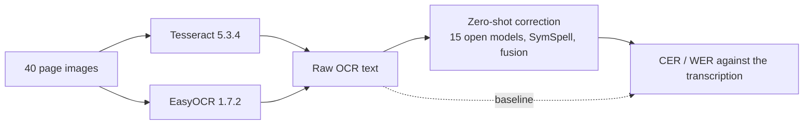
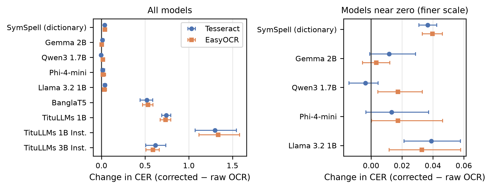

# bengali-postocr-sllm

Code, data splits, logs and paper for "Does Zero-Shot Small-Model Post-Correction Help Historical Bengali OCR? A Negative Result Across Eight Models and Two OCR Engines" (Arifur Rahman, CSE403, Bangladesh University of Business and Technology, 2026).

Paper: [paper/main.pdf](paper/main.pdf) (source [paper/main.tex](paper/main.tex)). Numbers: [context/results.md](context/results.md). Cite: [CITATION.cff](CITATION.cff).

## What the study does
I took 40 pages of Bengali books printed between 1713 and 1914 (REID2019, British Library), read them with Tesseract 5.3.4 and EasyOCR 1.7.2, and asked small open language models to correct the OCR text without any examples. I also tried a SymSpell dictionary, a fusion of the two engines, larger models, and a small model fine-tuned on synthetic errors. Every output was scored against the human transcription with CER and WER, with paired bootstrap intervals and Holm-corrected Wilcoxon tests.



## Result
No language model on its own significantly lowered the character error rate of either engine. Most left it about the same and several made it much worse.

<p align="center">
  
</p>

| Method | Tesseract CER | EasyOCR CER | Compared with raw OCR |
|---|---:|---:|---|
| Raw OCR (no correction) | 0.341 | 0.297 | |
| Gemma-2B-it | 0.353 | 0.301 | no significant change |
| Qwen3 1.7B | 0.337 | 0.315 | no significant change |
| Phi-4-mini | 0.354 | 0.315 | no significant change |
| Llama 3.2 1B | 0.380 | 0.330 | significantly worse |
| SymSpell dictionary | 0.378 | 0.337 | significantly worse |
| BanglaT5 | 0.860 | 0.831 | significantly worse |
| TituLLMs 1B | 1.084 | 1.033 | significantly worse |
| TituLLMs 1B Instruct | 1.642 | 1.633 | significantly worse |
| TituLLMs 3B Instruct | 0.958 | 0.886 | significantly worse |

"Significant" here means the Holm-corrected Wilcoxon test in the paper's full evaluation matrix. On EasyOCR the bootstrap intervals of Qwen3 1.7B ([+0.004, +0.033]) and Phi-4-mini ([+0.000, +0.046]) start at or above zero, so on that engine they lean worse, not better.

Other findings:
- General-purpose models mostly copy their input. The Bengali-pretrained checkpoints rewrite it and end up above CER 0.8. Every method changes some text that was already correct.
- Noisy input alone does not explain it. Correction also hurts on region-level OCR with lower CER, and on clean transcriptions corrupted to any CER from 0.02 to 0.30.
- A repetition penalty or n-gram ban in Hugging Face `generate` also acts on the prompt, so a model that copies its input gets penalised for it. Restricting both to the generated tokens removes much of the extra damage, but not all of it.
- Qwen3 4B, 8B and 32B fix more wrong words and lower WER, but their other edits (inside words that stay wrong, and in words that were already right) add about as many character errors as the repairs remove, so CER does not fall.
- A Wikipedia lexicon together with edit distance 1 cuts the dictionary's damage by about four-fifths, but it is still harmful. Fusing the two engines by word confidence lowers CER by about 1% (1.1% and 0.8% for the two rules), too little to matter.
- Keeping only the model edits on words the OCR engine was unsure of gives the study's one significant CER drop: 0.004 for Qwen3 1.7B on Tesseract at one threshold, about 1%.
- Grad-CAM maps agree with the copying: for most copied tokens the map peaks on that token in the OCR text. The maps are not a causal explanation.
- ByT5-small fine-tuned on synthetic noise does the least damage to clean text and lowers WER, but not CER.

## Repository layout
| Folder | Contents |
|---|---|
| `paper/` | `main.tex`, `references.bib`, generated `tables/` and `figures/`, the Bengali font, the compiled `main.pdf`, and `scripts/` that generate every table and figure. See [paper/README.md](paper/README.md). |
| `data/` | Frozen page lists (`split_dev.txt`, `split_eval.txt`, `excluded_no_ground_truth.txt`), page-type labels, the development-page noise model, the 10-page list of the large-model run, and the scripts that made them. The dataset itself is not committed. |
| `ocr/` | Whole-page OCR (`run_ocr.py`), word and box confidences (`run_ocr_conf.py`), region-level OCR from the PAGE-XML regions (`run_region_ocr.py`). |
| `correction/` | Models, prompts and decoding presets (`models.py`), chunking, the resumable sweep (`run_sweep.py`), the SymSpell baseline, engine fusion, the fine-tuning pilot (`finetune_byt5.py`). `sessions/` holds the drivers of the Kaggle GPU sessions. |
| `eval/` | Scoring (`metrics.py`: NFC-normalised CER and WER), bootstrap and Wilcoxon tests, every analysis, the synthetic-noise model, the Grad-CAM attribution, and the data leakage check (`check_leakage.py`). |
| `notebooks/` | `kaggle/`: the GPU and CPU sessions that produced the results. `colab/`: the first CPU pipeline on 15 pages. |
| `tools/` | `run_logged.py` runs a command and saves its output, exit code, timing, git commit and package versions in `logs/`. `compare_outputs.py` checks a rerun against a saved result file. |
| `logs/` | Records of runs made with `run_logged.py` (see [logs/README.md](logs/README.md)) and the leakage report. |
| `summaries/` | Numeric outputs of the analyses that the tables and figures are built from. No page text. |
| `context/` | Decisions with reasons, results, timeline, engineering notes and the review responses. |
| `results/` | Run outputs and the original Kaggle logs (local only, gitignored). |

[ENVIRONMENT.md](ENVIRONMENT.md) records versions, checkpoints and settings.

## Reproducing
1. Dataset: the REID2019 Bengali ground truth from the British Library, version 2 ([doi:10.23636/1168](https://doi.org/10.23636/1168), public domain). Unzip it locally or in the Colab/Kaggle runtime.
2. Python: `python -m venv .venv`, activate it, then `pip install -r requirements.txt`. The exact versions used for the analysis are in `requirements-lock-analysis.txt`.
3. Tesseract: install the binary and put `ben.traineddata` from `tessdata_best` in `.tessdata/`, with `TESSDATA_PREFIX` pointing there. Tesseract 5.3.4 no longer reproduces the main run's text (see ENVIRONMENT.md), so the main OCR files are kept as released data.
4. Hugging Face: Gemma, Gemma 3 and Llama are gated. Accept their licences and give `HF_TOKEN` as a Kaggle/Colab secret.
5. Run: OCR with `ocr/`; correction with the notebooks in `notebooks/kaggle/` (they clone this repo and call `correction/run_sweep.py` or a driver in `correction/sessions/`); the dictionary baseline with `correction/dictionary_baseline.py`; analyses, tables and figures with the commands in [paper/README.md](paper/README.md), from the repository root.

To rescore everything and rebuild all generated tables in one go, with the run logged:

```
python tools/run_logged.py --label reproduce-tables -- bash paper/scripts/reproduce_tables.sh
```

Set `PY` to the project's Python first if `python` is not the venv. On Windows, scripts that print Bengali re-wrap stdout as UTF-8 so the console does not crash.

## Data and licence
The code is not released under any licence yet. The per-page OCR text and model outputs are not in this repository; they will be released separately with the final paper. The page images are out of copyright and the transcriptions carry the Public Domain Mark. The bundled font, Noto Serif Bengali, is under the SIL Open Font License. Model checkpoints are under their own licences and are not redistributed here.
