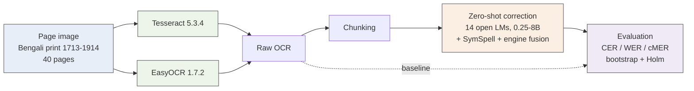
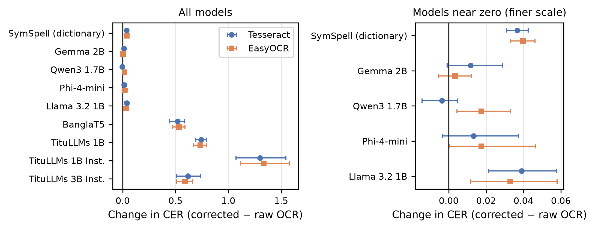
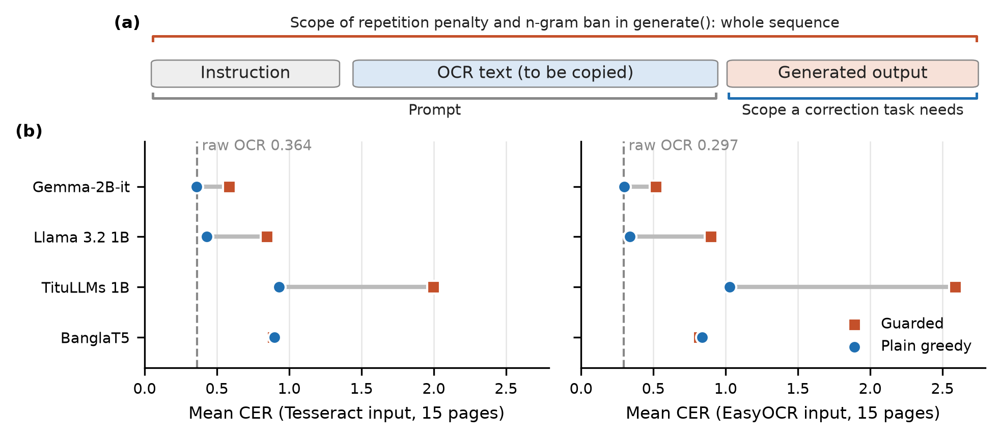

# Does Zero-Shot Small-Model Post-Correction Help Bengali OCR?

### A negative result across eight models and two OCR engines

Arifur Rahman · CSE403 · Bangladesh University of Business and Technology · 2026

> **Short answer: no.** Across 40 historical Bengali pages, no language model lowers the character error rate (CER) of Tesseract or EasyOCR output. Most leave it unchanged; many make it worse.

**Paper:** [paper/main.pdf](paper/main.pdf) (source: [paper/main.tex](paper/main.tex)) · **Cite:** [CITATION.cff](CITATION.cff) · **Numbers:** [context/results.md](context/results.md)

## The study

## Headline result

  

<em>Change in CER after correction (right of the line = worse), with 95% bootstrap intervals. Nothing lands clearly left of zero.</em>

| Method | Tesseract CER | EasyOCR CER | vs. raw OCR |
|---|---:|---:|---|
| **Raw OCR (baseline)** | **0.341** | **0.297** | — |
| Gemma 2B | 0.353 | 0.301 | no significant change |
| Qwen3 1.7B | 0.337 | 0.315 | no significant change |
| Phi-4-mini | 0.354 | 0.315 | no significant change |
| Llama 3.2 1B | 0.380 | 0.330 | significantly worse |
| SymSpell dictionary | 0.378 | 0.337 | significantly worse |
| BanglaT5 | 0.860 | 0.831 | significantly worse |
| TituLLMs 1B | 1.084 | 1.033 | significantly worse |
| TituLLMs 3B Instruct | 0.958 | 0.886 | significantly worse |

## Key findings

| | Finding |
|---|---|
| 🔁 | **General-purpose models copy their input; Bengali-pretrained models regenerate it** (CER above 0.8). Every method damages error-free text. |
| 🧪 | **Noisy input is not the explanation.** Correction also hurts on region-level OCR with lower CER, and on reference text corrupted to any CER from 0.02 to 0.30. |
| ⚠️ | **A common decoding default misleads evaluations.** A repetition penalty or n-gram ban in Hugging Face `generate` also acts on the prompt and makes copying models look harmful (figure below). |
| 📈 | **Bigger Qwen3 models** (4B, 8B, 32B) fix more wrong words and lower WER, but break correct ones, so CER does not fall. |
| 📖 | **No language model needed?** A Wikipedia lexicon cuts the dictionary's damage by four-fifths but it stays harmful; fusing the two engines by word confidence fixes more than it breaks, yet lowers CER by under 1%. |
| 🔬 | **Grad-CAM** shows the copying from inside: copied tokens rely on their own source token. |
| 🛠️ | **Fine-tuning** ByT5-small on synthetic noise gives the least damage to clean text and lowers WER, but not CER. |

  

<em>The repetition penalty and n-gram ban cover the prompt as well as the output, so a model that only copies is penalised for copying.</em>

## Repository layout
| Folder | Contents |
|---|---|
| `paper/` | `main.tex`, `references.bib`, generated `tables/` and `figures/`, the Bengali font, the compiled `main.pdf`, and `scripts/` that generate every table and figure. See [paper/README.md](paper/README.md). |
| `data/` | Frozen page lists (`split_dev.txt`, `split_eval.txt`, `excluded_no_ground_truth.txt`), page-type labels, the development-page noise model, the 10-page list of the large-model run, and the scripts that made them. The dataset itself is not committed. |
| `ocr/` | Whole-page OCR (`run_ocr.py`), word and box confidences (`run_ocr_conf.py`), region-level OCR from the PAGE-XML regions (`run_region_ocr.py`). |
| `correction/` | The correction harness: models, prompts, decoding presets (`models.py`), chunking, the resumable sweep (`run_sweep.py`), the SymSpell baseline, the fine-tuning pilot (`finetune_byt5.py`), the float16 check. `sessions/` holds the drivers of the Kaggle GPU sessions. |
| `eval/` | Scoring (`metrics.py`: NFC-normalised CER, WER, cMER), paired bootstrap and Holm-corrected Wilcoxon tests, every analysis, the synthetic-noise model (`make_noise.py`) and the Grad-CAM attribution (`xai_gradcam.py`). |
| `notebooks/` | `kaggle/`: the GPU and CPU sessions that produced the results (main run, prompt variants, region OCR, third-review runs a-d). `colab/`: the first-version CPU pipeline on 15 pages (decoding comparison and CPU timings). |
| `summaries/` | Numeric outputs of the analyses that the tables and figures are built from. No page text. |
| `context/` | The project's memory: decisions with reasons, results, timeline, engineering notes, the third review with status, and the handoff for the next session. |
| `results/` | Run outputs (local, gitignored). |

## Reproducing
1. **Dataset:** the REID2019 Bengali ground truth from the British Library, version 2 ([doi:10.23636/1168](https://doi.org/10.23636/1168); public domain). Unzip it locally or in the Colab/Kaggle runtime.
2. **Python:** `python -m venv .venv`, activate it, `pip install -r requirements.txt`.
3. **Tesseract:** install the binary and put `ben.traineddata` from `tessdata_best` in `.tessdata/`, with `TESSDATA_PREFIX` pointing there. Note that Tesseract 5.3.4 no longer reproduces the main run's text (ENVIRONMENT.md), so the main OCR files are kept as released data.
4. **Hugging Face:** Gemma, Gemma 3 and Llama are gated; accept their licences and provide `HF_TOKEN` as a Kaggle/Colab secret.
5. **Run:** OCR with `ocr/`; correction with the notebooks in `notebooks/kaggle/` (they clone this repo and call `correction/run_sweep.py` or a driver in `correction/sessions/`); the dictionary baseline with `correction/dictionary_baseline.py`; analyses, tables and figures with the commands in [paper/README.md](paper/README.md), from the repository root.

On Windows, scripts that print Bengali re-wrap stdout as UTF-8 so the console does not crash.

## Data and release
The code is not released under any licence. The per-page OCR text and model outputs are not in this repository; they will be released separately together with the final paper. The page images are out of copyright and the transcriptions carry the Public Domain Mark. The bundled font, Noto Serif Bengali, is under the SIL Open Font License. Model checkpoints are under their own licences and are not redistributed here.
